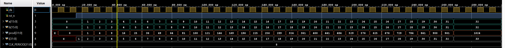
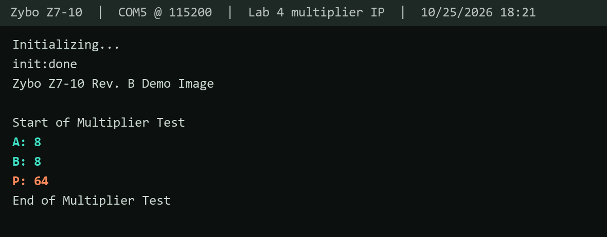
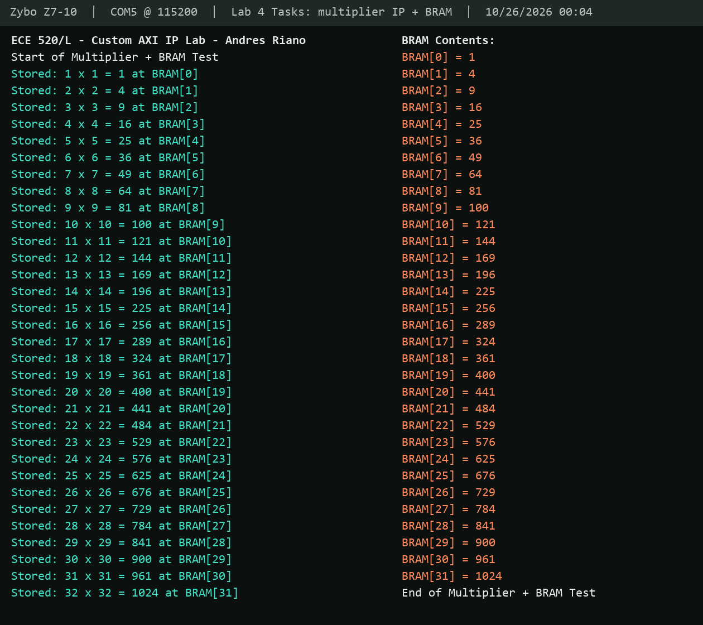

# ECE 520 Lab 4: Custom AXI-Lite IP

Andres Riano · ECE 520 · Fall 2026 · Zybo Z7-10 · Vivado / Vitis 2023.2

Two custom AXI4-Lite peripherals on the Zynq programmable logic, controlled from C on the ARM:

1. **`mult_16_bit`**: a 16-bit multiplier (registered 32-bit product) behind three memory-mapped registers.
2. **`sc_fifo_axi`**: my Lab 3 BRAM FIFO wrapped as an AXI IP with a full register map (push, pop, reset, status, count, configuration).

Plus the **Tasks**: an AXI BRAM Controller + Block Memory Generator in the same design, filled with 32 products computed by the multiplier IP.

## Repository layout

```
src/multiplier_16_bit.v           16-bit multiplier (registered output)
sim/tb_multiplier_16_bit.v        multiplier testbench (32 pairs, one per clock)
sim/tb_sc_fifo_axi.v              self-checking AXI4-Lite testbench for the FIFO IP (26 checks)
ip_repo/mult_16_bit_1_0/          packaged multiplier IP (AXI wrapper edits in hdl/)
ip_repo/sc_fifo_axi_1_0/          packaged FIFO IP (hdl/sc_fifo.v from Lab 3 + AXI wrapper)
sw/part1_multiplier_test.c        Part 1: write A, B, read the product
sw/tasks_bram_test.c              Tasks: 32 products stored in BRAM, read back and printed
sw/part6_fifo_test.c              Part 6: push / pop / status / config test of the FIFO IP
demo/                             built bitstream, .xsa, .elf files and run.tcl (no rebuild needed)
images/                           waveform and serial-terminal results
```

## Address map (Vivado Address Editor)

| Peripheral | Base address | Range |
|---|---|---|
| `mult_16_bit_0` | `0x43C0_0000` | 64K |
| `sc_fifo_axi_0` | `0x43C1_0000` | 64K |
| `axi_bram_ctrl_0` | `0x4000_0000` | 64K |

The PL runs on the PS clock FCLK_CLK0 = **50 MHz**.

## Part 1: multiplier IP registers

| Offset | Register | Access | Contents |
|---|---|---|---|
| 0x00 | `slv_reg0` | R/W | A in bits [15:0] (upper 16 bits read as 0) |
| 0x04 | `slv_reg1` | R/W | B in bits [15:0] (upper 16 bits read as 0) |
| 0x08 | `slv_reg2` | RO | product A × B, 32 bits (software writes ignored) |

The multiplier maps onto **one DSP48E1** slice (utilization report). Timing met with +12.85 ns slack at 50 MHz.

## Part 6: FIFO IP register map

| Offset | Register | Access | Contents |
|---|---|---|---|
| 0x00 | FPGA_REV_REG | RO | `0x5200_0004` |
| 0x04 | FIFO_RST_REG | WO | write 1 → `srst` pulses for one clock |
| 0x08 | WR_DATA_REG | WO | any write → push `WDATA[15:0]`, `write_enable` pulses for one clock |
| 0x0C | RD_REQ_REG | WO | write 1 → `read_enable` pulses for one clock, clears RD_VALID |
| 0x10 | RD_DATA_REG | RO | last popped word, captured when `sc_fifo` asserts `valid` |
| 0x14 | STATUS_REG | RO | [4] RD_VALID · [3] almost_full · [2] almost_empty · [1] full · [0] empty (reset `0x05`) |
| 0x18 | DATA_COUNT_REG | RO | words in the FIFO (0–32) |
| 0x1C | CONFIG_REG | RO | {READ_LATENCY, DEPTH, WIDTH} = `0x0100_2010`, built from the parameters |
| 0x20 | THRESHOLD_REG | RO | {ALMOST_FULL, ALMOST_EMPTY} = `0x001F_0001`, built from the parameters |
| 0x24–0x3C | reserved | – | read 0 |

**Why pulses:** a value held in a register would push or pop on *every* clock. `slv_reg_wren` is high for exactly one clock per AXI write, so each command is `slv_reg_wren && (write address == that register)`, registered once. The FIFO resets when `S_AXI_ARESETN` is low (active-low) **or** when the software reset pulse fires (FIFO `srst` is active-high).

**Popping takes two steps:** write 1 to RD_REQ_REG, then poll STATUS bit 4 (RD_VALID) and read RD_DATA_REG. The read is not instant because `sc_fifo`'s output is registered (READ_LATENCY clocks).

## How to run on the board (no rebuild)

1. Plug in the Zybo (PROG/UART micro-USB), power ON. Open a serial terminal at **115200 baud** on the board's COM port.
2. From the `demo/` folder, run Xilinx's debugger (comes with Vitis):
   ```
   xsdb run.tcl bram
   xsdb run.tcl fifo
   ```
   `bram` runs the multiplier + BRAM test; `fifo` runs the FIFO IP test. The script programs the FPGA, initializes the PS, loads the program and starts it.

## How to rebuild

1. Vivado: new project, Zybo Z7-10, add `ip_repo/` as an IP repository (Settings → IP → Repository).
2. Block design: ZYNQ7 Processing System (Run Block Automation) + `mult_16_bit` + `sc_fifo_axi` + AXI BRAM Controller + Block Memory Generator, Run Connection Automation, set the address ranges above, Validate, HDL wrapper, Generate Bitstream, Export Hardware (include bitstream).
3. Vitis Unified IDE: platform from the `.xsa` (standalone, ps7_cortexa9_0), application component, add the C file from `sw/`, build, run.

## Results

**Multiplier testbench:** product = A × B one clock after the inputs (32 × 32 = 1024 at the end).


**Part 1 on the board:** A: 8, B: 8, P: 64.


**Tasks on the board:** 32 products stored at `BRAM_BASE_ADDR + k*4` and read back, BRAM[0] = 1 … BRAM[31] = 1024.


**FIFO IP simulation:** 26 checks, 0 errors: reset values, push 5 / pop 5 in order, pop-when-empty ignored, RD_REQ write of 0 ignored, software reset, fill to 32 with the 33rd write ignored, writes to read-only registers have no effect.

**FIFO IP on the board:** see `images/serial_fifo.png`.

## Notes (things that went wrong and how they were fixed)

- The first `.xsa` export after adding the BRAM still contained the **old bitstream** (synthesis had not re-run). Always wait for "Bitstream Generation successfully completed" before exporting.
- **Vitis 2023.2 Unified:** the generated launch configuration pointed the PS init script at `mult_16_bit.tcl` instead of `ps7_init.tcl` ("invalid command name ps7_init"). Fixed in `_ide/.theia/launch.json`. A folder opened once by Vitis Classic cannot be used as a Unified workspace.
- After re-packaging an IP, the block design locks it until **Upgrade IP** is run.

## AI use (citation)

Per the ECE 520 syllabus, outside help is cited. **Claude (Anthropic)** was used as a tutor and assistant:
- `multiplier_16_bit.v` and `tb_multiplier_16_bit.v`: typed by me from Claude scaffolds; I filled the reset condition, the product, and the stimulus.
- Multiplier AXI wrapper edits: the code given in the lab instructions, typed by me.
- `tasks_bram_test.c`: Claude skeleton; I filled the product read and the BRAM address (`k * 4`); Claude supplied the read-back line and print arguments.
- `sc_fifo.v`: my Lab 3 design, unchanged.
- `sc_fifo_axi` user logic (pulses, reset, FIFO instance, read capture, read mux): drafted by Claude; I answered the read-request pulse condition. `tb_sc_fifo_axi.v`, `part6_fifo_test.c`, `demo/run.tcl` and this README: drafted by Claude, reviewed by me.
